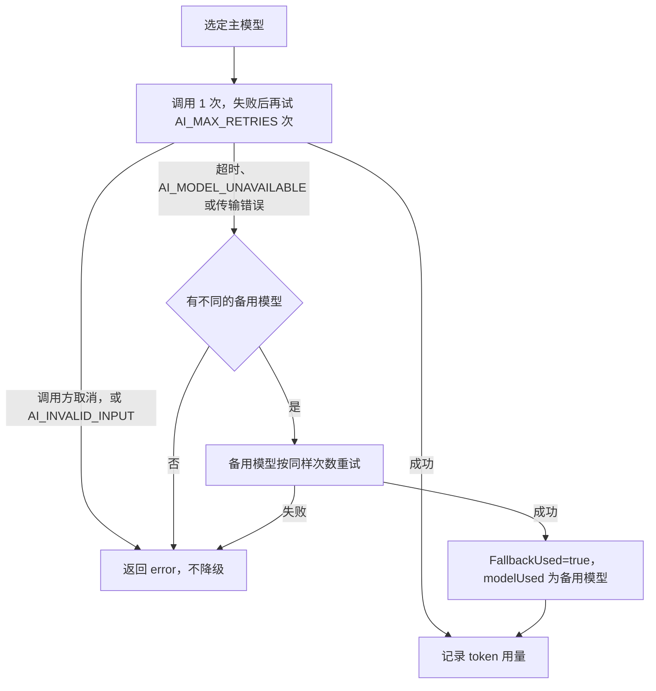

# AI 子系统

内部 Go 包。提供整课生成、单章生成、单 activity 生成、质量评估，以及 JSON 解析、schema 校验、重试和降级。

不访问数据库，不注册 HTTP 路由，也不区分讲师和学生。权限、课程归属和入库由业务层完成。不要把 `ownerId`、`isPublished` 放进 AI 入参。本包不提供 `POST /api/ai/*`。

## 调用关系

```mermaid
flowchart TD
  handler["业务 handler：权限和归属"] --> service["业务 service"]
  service --> ai["caveclass/internal/ai"]
  ai --> call["llm.Call：超时、重试、降级"]
  call --> client["llm.Client"]
  client --> mock["mock 固定 JSON"]
  client --> real["openai / azure：尚未实现"]
  ai --> parse["parse：提取 JSON、repair、Normalize、Validate"]
```

成功时把课程或报告放进业务响应的 `data`，把 `meta` 放进 `data.meta`。

## 包

| 路径 | 作用 |
|------|------|
| `caveclass/internal/ai` | 门面：`New`、`NewFromEnv`、`GenerateCourse`、`GenerateChapter`、`GenerateActivity`、`EvaluateCourse`、`Meta`、`LogError` |
| `internal/ai/aierr` | `aiCode` 和 `ToAppError` |
| `internal/ai/course` | 标准课程、`Validate`、`Normalize` |
| `internal/ai/quality` | 质量报告 |
| `internal/ai/parse` | `ParseCourseJSON`、`ParseChapterJSON`、`ParseActivityJSON`、`ParseQualityJSON` |
| `internal/ai/prompt` | `full_course_v1`、`chapter_v1`、`activity_v1`、`content_quality_v1`，version 都是 `"1"` |
| `internal/ai/validate` | 入参长度、枚举和注入拦截 |
| `internal/ai/llm` | 配置、mock 客户端、`Call` |

`AI_*` 还没有接进 `platform/config` 和进程启动。调用方自己 `NewFromEnv` 或 `New`。

## 环境变量

| 变量 | 默认 | 说明 |
|------|------|------|
| `AI_PROVIDER` | `mock` | `mock`、`deepseek`、`teamily`、`openai`、`azure` |
| `AI_API_KEY` | 空 | 只放在本机环境变量或 `backend/.env`。示例见 `backend/.env.example`。`.env` 已被 git 忽略，不要写进代码 |
| `AI_MODEL_PRIMARY` | `gpt-4o-mini` | 主模型 |
| `AI_MODEL_FALLBACK` | 空 | 备用模型。空或与主模型相同则不降级 |
| `AI_TIMEOUT` | `60s` | 每次尝试单独计时 |
| `AI_MAX_RETRIES` | `1` | 每个模型首次失败后的额外次数。`0` 表示不重试 |
| `AI_MAX_TOPIC_LEN` | `500` | `topic` 的 rune 上限 |

`deepseek` 使用 OpenAI 兼容接口，默认地址是 `https://api.deepseek.com/chat/completions`，默认模型是 `deepseek-chat`。未设置 `AI_MODEL_PRIMARY` 时，DeepSeek 不会把 `gpt-4o-mini` 发给接口。

`teamily` 调用 agent responses：请求体是 `input`、`thread.mode=new`、`wait=true`，正文取 `output.text`。默认地址写在代码里，换 agent 时设置 `AI_BASE_URL`。用量使用 `input_tokens` 和 `output_tokens`。

`AI_BASE_URL` 可改地址。`openai` 和 `azure` 的客户端还没有实现，`NewClient` 返回 `AI_MODEL_UNAVAILABLE`。

本地真实调用把密钥写在 `backend/.env`，字段对照 `backend/.env.example`。然后在 `backend` 目录执行 `go run ./cmd/ai-live`。这个命令会读取 `.env`，依次跑整课、单章、activity 和质量评估。库代码本身只读进程环境变量，不会自动加载 `.env`。CI 和单测继续用 `AI_PROVIDER=mock`。

## 生成整课

```go
service, err := ai.NewFromEnv()
generated, meta, err := service.GenerateCourse(ctx, ai.GenerateCourseInput{
    Topic:             "Git 入门",
    Audience:          "NON_CS",
    Language:          "zh-CN",
    ExtraRequirements: "多举例子",
    ChapterCountHint:  4,
})
```

| 字段 | 约束 |
|------|------|
| `topic` | 必填，1～`AI_MAX_TOPIC_LEN`，默认 500 |
| `audience` | `CS`、`NON_CS`、`GENERAL` |
| `language` | `zh-CN` 或 `en-US`。空则 `zh-CN` |
| `extraRequirements` | 可选，最长 2000 |
| `chapterCountHint` | 0～30。0 表示不指定 |
| `model` | 可选。空则用 `AI_MODEL_PRIMARY` |
| `templateId` | 可选。空则 `full_course_v1`。其它值返回 `AI_INVALID_INPUT` |

`topic` 和 `extraRequirements` 会做注入拦截。明显的角色劫持、忽略先前指令，以及闭合 `<user_topic>`、`<extra_requirements>`、`<rubric>` 标签会被拒绝，并返回 `AI_PROMPT_INJECTION_SUSPECT`，且不会调用模型。

## 生成章节和 activity

```go
chapter, meta, err := service.GenerateChapter(ctx, ai.GenerateChapterInput{
    Topic:            "分支",
    Audience:         "CS",
    TargetChapterKey: "ch-9",
    ContextCourse:    &generated,
})

activity, meta, err := service.GenerateActivity(ctx, ai.GenerateActivityInput{
    Topic:             "命令",
    Audience:          "GENERAL",
    TargetChapterKey:  "ch-1",
    TargetActivityKey: "act-1-1",
    ContextCourse:     &generated,
})
```

`targetChapterKey` 必填。生成 activity 时 `targetActivityKey` 也必填。key 去掉首尾空白后长度为 1～128。`contextCourse` 可选：有则把课程 JSON 放进 Prompt；没有则仍然成功，`meta.warnings` 含 `contextCourse was not provided`。模型返回的 key 会改成请求里的目标 key，并记入 `meta.validation.repairedFields`。

模板空则分别为 `chapter_v1`、`activity_v1`。

## 质量评估

```go
report, meta, err := service.EvaluateCourse(ctx, generated, "强调练习是否够具体")
```

课程必须先通过 `Validate`。`rubric` 可空，最长 2000。报告字段：

| 字段 | 约束 |
|------|------|
| `overallScore` | 0～100 的整数 |
| `summaryMarkdown` | 必填，最长 4000 |
| `dimensions` | 必须各出现一次：`coverage`、`clarity`、`practice`、`audience_fit`。每项有 `name`、`score`（0～100）和 `comment` |
| `suggestions` | 字符串数组，最多 20 条。缺失时补成空数组，并记入 `repairedFields` |

## 标准课程 JSON

`schemaVersion` 当前为 `"1.0"`。字段使用驼峰。

| 字段 | 必填 | 约束 |
|------|------|------|
| `schemaVersion` | 是 | `"1.0"` |
| `title` | 是 | 1～200 |
| `description` | 否 | 最长 2000 |
| `audience` | 是 | `CS`、`NON_CS`、`GENERAL` |
| `language` | 是 | `zh-CN`、`en-US` |
| `estimatedMinutes` | 否 | 缺失可补 0，并写入 warning |
| `chapters` | 是 | 至少 1 章。每章至少 1 个 activity |

章节字段：`key`、`title`、`summary`、`order`、`activities`。`key` 最长 128，供局部重生成后合并。

activity 字段：`key`、`type`、`title`、`order`、`payload`。`type` 只能是 `rich_text`、`coding`、`mock_interview`、`quiz_game`。

`rich_text` 的 payload：

```json
{ "markdown": "string", "highlights": ["string"] }
```

`coding` 的 payload。`language` 为 `python`、`javascript`、`java`、`go`、`other`：

```json
{
  "language": "other",
  "promptMarkdown": "string",
  "starterCode": "string",
  "solutionHint": "string",
  "testCases": [{ "input": "string", "expectedOutput": "string", "isHidden": false }]
}
```

`mock_interview` 的 payload：

```json
{
  "role": "string",
  "scenarioMarkdown": "string",
  "questions": [{ "question": "string", "followUpHints": ["string"] }],
  "evaluationRubricMarkdown": "string"
}
```

`quiz_game` 的 payload。`correctIndex` 从 0 开始：

```json
{
  "instructionsMarkdown": "string",
  "questions": [{
    "question": "string",
    "options": ["string"],
    "correctIndex": 0,
    "explanation": "string"
  }]
}
```

下面是一份能通过 `Validate` 的课程。测试夹具 `course/testdata/mini_course.json` 与此相同。

```json
{
  "schemaVersion": "1.0",
  "title": "Introduction to Git for Beginners",
  "description": "Learn basic Git commands and workflow.",
  "audience": "NON_CS",
  "language": "zh-CN",
  "estimatedMinutes": 45,
  "chapters": [
    {
      "key": "ch-1",
      "title": "What is Version Control",
      "summary": "Concepts of VC and Git.",
      "order": 1,
      "activities": [
        {
          "key": "act-1-1",
          "type": "rich_text",
          "title": "Read: Git Basics",
          "order": 1,
          "payload": {
            "markdown": "## Git 是什么\n\nGit 是分布式版本控制系统……",
            "highlights": ["版本控制", "分布式"]
          }
        },
        {
          "key": "act-1-2",
          "type": "quiz_game",
          "title": "Quick Check",
          "order": 2,
          "payload": {
            "instructionsMarkdown": "选择正确答案。",
            "questions": [
              {
                "question": "Git 是？",
                "options": ["版本控制系统", "数据库", "浏览器", "操作系统"],
                "correctIndex": 0,
                "explanation": "Git 用于管理代码版本。"
              }
            ]
          }
        }
      ]
    },
    {
      "key": "ch-2",
      "title": "First Commands",
      "summary": "init, add, commit.",
      "order": 2,
      "activities": [
        {
          "key": "act-2-1",
          "type": "coding",
          "title": "Practice: git status",
          "order": 1,
          "payload": {
            "language": "other",
            "promptMarkdown": "在终端中写出查看仓库状态的命令。",
            "starterCode": "# write your command\n",
            "testCases": [
              { "input": "", "expectedOutput": "git status", "isHidden": false }
            ]
          }
        }
      ]
    }
  ]
}
```

`Validate` 不改数据，失败返回 `*course.ValidationError`。`Normalize` 不报错：丢掉非法 `type` 的 activity，丢掉因此变空的章节，再把 `order` 重写成从 1 开始的连续序号。

## meta

```json
{
  "scene": "full_course",
  "templateId": "full_course_v1",
  "templateVersion": "1",
  "modelRequested": "gpt-4o-mini",
  "modelUsed": "gpt-4o-mini",
  "fallbackUsed": false,
  "latencyMs": 3200,
  "usage": { "promptTokens": 0, "completionTokens": 0, "totalTokens": 0 },
  "warnings": [],
  "validation": { "passed": true, "repairedFields": [] },
  "requestId": ""
}
```

`scene` 为 `full_course`、`chapter`、`activity`、`evaluate`。`requestId` 来自 context 里已有的请求 ID，没有则留空。

## 降级



成功日志的字段是 `model`、`fallbackUsed`、`promptTokens`、`completionTokens`、`totalTokens`。日志不包含 prompt 和 API key。

## 错误

先 `LogError`，再 `aierr.ToAppError`。400 转换后的业务错误不再带 `aiCode`，所以 `errors.Is` 要在转换前做。

```go
generated, meta, err := service.GenerateCourse(ctx, input)
if err != nil {
    ai.LogError(ctx, err, meta, uid)
    return aierr.ToAppError(err)
}
```

| aiCode | 给前端 | 含义 |
|--------|--------|------|
| `AI_INVALID_INPUT` | 400 | 入参不合法 |
| `AI_INPUT_TOO_LONG` | 400 | 超长 |
| `AI_PROMPT_INJECTION_SUSPECT` | 400 | 注入拦截 |
| `AI_OUTPUT_PARSE_FAILED` | 400 | 提取不出 JSON |
| `AI_OUTPUT_SCHEMA_FAILED` | 400 | JSON 不符合 schema |
| `AI_MODEL_UNAVAILABLE` | 500 | 主备都失败，或真实客户端未实现 |
| `AI_TIMEOUT` | 500 | 超时或调用被取消 |
| `AI_INTERNAL` | 500 | 其它内部错误 |

`LogError` 的字段是 `aiCode`、`details`、`meta`、`uid`。`uid` 由业务层传入，本包不查库。失败案例看这条 slog。非致命问题看 `meta.warnings`，例如没有课程上下文，或 `estimatedMinutes` 被补成 0。

业务层入库前自己设置所有者，并把 `isPublished` 设为 false。

## 解析

模型原文或外部 JSON 不要直接入库。

```go
parsed, report, err := parse.ParseCourseJSON(rawText, true)
```

`repair=true` 只补缺失或空白的 `schemaVersion=1.0`、`language=zh-CN`，以及缺失的 `estimatedMinutes=0`。已有的非法值不会被覆盖。然后 `Normalize`，再 `Validate`。章节和 activity 用 `ParseChapterJSON`、`ParseActivityJSON`。质量报告用 `ParseQualityJSON`。
